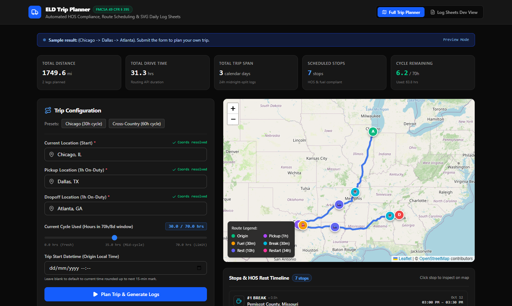
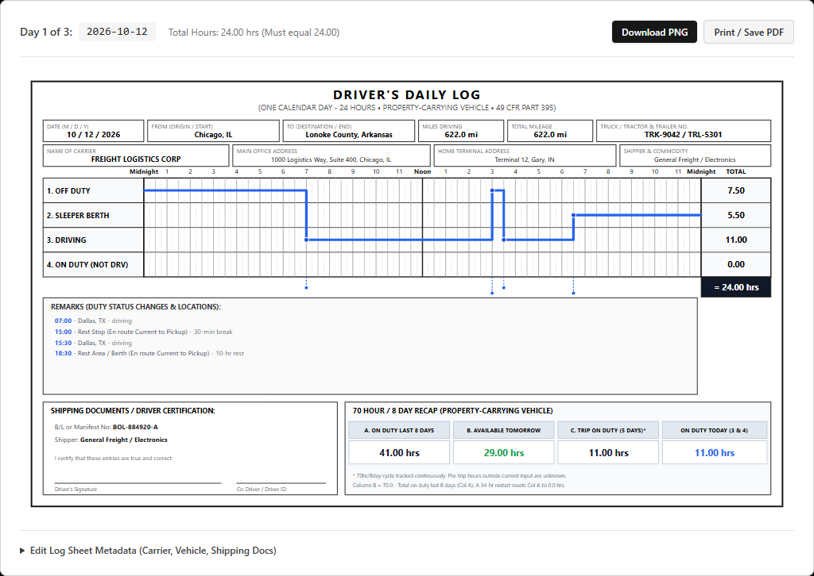

# ELD Trip Planner

A full-stack FMCSA-compliant ELD (Electronic Logging Device) trip planner built with Django REST Framework and React (Vite + Leaflet + Tailwind CSS). It takes a driver's current location, pickup destination, dropoff destination, and current cycle hours used; it calculates real-world turn-by-turn routes, schedules required HOS rest breaks and fuel stops, and dynamically renders compliant Driver's Daily Log sheets with PDF/PNG export.

---

## Live Demo

| Service | URL |
|---------|-----|
| **Frontend Application** | [https://eld-trip-planner-xi-sable.vercel.app](https://eld-trip-planner-xi-sable.vercel.app) |
| **Backend REST API** | [https://eld-trip-planner-api-gumw.onrender.com](https://eld-trip-planner-api-gumw.onrender.com) |
| **GitHub Repository** | [https://github.com/osaidzagha/eld-trip-planner](https://github.com/osaidzagha/eld-trip-planner) |

---

## Visual Overview

### Trip Planner & Interactive Route Scheduling


### FMCSA Vector Daily Log Sheet (Print & SVG Vector Grid)


---

## Architecture

```
┌─────────────────────────────────────────────────────────────────┐
│  Browser (React 19 + Vite 8 + Tailwind CSS v4)                  │
│  • TripForm (Debounced geocoding search + presets)              │
│  • MapView (Leaflet + OSM tiles + custom SVG markers)           │
│  • StopsTimeline (Scheduled HOS rests, breaks, and fuel stops)  │
│  • LogViewer → LogSheet (Pure SVG FMCSA 24h grid, PDF export)   │
└────────────────────────────────┬────────────────────────────────┘
                                 │ HTTPS / JSON
┌────────────────────────────────▼────────────────────────────────┐
│  Django 6 REST API (Render / Gunicorn + WhiteNoise)             │
│  • GET  /api/health/          Zero-dependency health probe      │
│  • GET  /api/geocode/?q=      Nominatim + Photon fallback       │
│  • POST /api/plan-trip/       Full routing, HOS engine & logs   │
│    ├─ planner/services.py     Geocoding, OSRM/ORS routing cache │
│    ├─ hos_engine.py           Pure-Python HOS state machine     │
│    └─ timezonefinder          Origin timezone auto-resolution   │
└─────────────────────────────────────────────────────────────────┘
         │ Nominatim / Photon API (geocoding & reverse geocoding)
         │ OSRM public API (routing, default)
         │ OpenRouteService (routing, when ORS_API_KEY is configured)
```

---

## HOS Rules Implemented

Built strictly against the property-carrying driver regulations under **FMCSA 49 CFR Part 395**:

| Rule | Limit | Reset / Trigger Condition |
|------|-------|---------------------------|
| **11-Hour Driving Limit** | Max 11 hours behind the wheel | Resets after 10 consecutive hours off duty (`SLEEPER`). |
| **14-Hour Duty Window** | Driving prohibited after 14th consecutive hour from coming on duty | Resets after 10 consecutive hours off duty (`SLEEPER`). **Never pauses** for meal breaks or off-duty periods. |
| **30-Minute Rest Break** | Mandatory after 8 cumulative hours of driving | Satisfied by any 30+ consecutive minutes of non-driving status (`ON_DUTY_NOT_DRIVING`, `OFF_DUTY`, or `SLEEPER`). Fuel stops and pickup/dropoff qualify. |
| **70-Hour / 8-Day Cycle** | Driving prohibited once 70 cumulative on-duty hours are reached | Resets to 0.0 hours after a 34 consecutive hour restart (`OFF_DUTY`). |

### Duty Statuses
1. `OFF_DUTY`: Off duty time and 34-hour cycle restarts.
2. `SLEEPER`: Mandatory 10-hour rest periods in sleeper berth.
3. `DRIVING`: Behind the wheel on route legs.
4. `ON_DUTY_NOT_DRIVING`: 1 hour at pickup, 1 hour at dropoff, and 30-minute fuel stops.

### Assumptions & Business Logic
1. **Fresh Shift at Start**: The driver starts the trip as a fresh shift with 10+ hours off duty prior to departure. The 11-hour driving and 14-hour duty clocks start at trip start.
2. **Cycle Hours Roll-Off Simplification**: Cumulative on-duty hours accumulate monotonically from `cycle_used_hrs`. Hours from prior days do not roll off mid-trip (conservative safety simplification).
3. **Fuel Stops**: A 30-minute `ON_DUTY_NOT_DRIVING` fuel stop is inserted at least once every 1,000 miles driven.
4. **Pickup & Dropoff**: Exactly 1.0 hour `ON_DUTY_NOT_DRIVING` each. Trip order: Current Location -> Driving -> Pickup (1h) -> Driving -> Dropoff (1h).
5. **Real-World Durations**: Driving distance and duration are fetched from OSRM/ORS turn-by-turn routing (no fixed-speed assumptions).
6. **Timezone & Midnight Splitting**: Daily logs are sliced midnight-to-midnight in the origin terminal's local timezone (resolved via `timezonefinder`, falling back to UTC). Each calendar day's 4 status rows sum to exactly **24.00 hours**.

---

## Known Limitations

- **Free-Tier Cold Starts**: Render free-tier web services spin down after 15 minutes of inactivity. Initial request may take ~50-60 seconds to wake up. The app fires a background health ping on mount and displays a waking status banner if requests take longer than 5 seconds.
- **Shared Public Map APIs**: Public OSRM routing and Nominatim geocoding are free, rate-limited public endpoints (1 req/sec). Nominatim automatically fails over to Komoot Photon if rate-limited or blocked.
- **Rural Reverse-Geocoding**: Stops in rural highway segments without incorporated municipality boundaries show county or mile marker labels (e.g., `Lonoke Co., AR`).
- **8-Day Rolling Window**: As noted in assumptions, hours from day -8 are not subtracted as days advance.

---

## Local Setup

### Prerequisites
- Python ≥ 3.11 (tested on Python 3.12 and 3.14)
- Node.js ≥ 20

### 1 — Clone Repository
```bash
git clone https://github.com/osaidzagha/eld-trip-planner.git
cd eld-trip-planner
```

### 2 — Backend Setup

#### Windows (PowerShell)
```powershell
cd backend
python -m venv venv
.\venv\Scripts\activate
pip install -r requirements.txt
python manage.py migrate

# Run dev server with DEBUG=1
$env:DEBUG="1"
python manage.py runserver 127.0.0.1:8000
```

#### macOS / Linux (Bash)
```bash
cd backend
python3 -m venv venv
source venv/bin/activate
pip install -r requirements.txt
python manage.py migrate

# Run dev server with DEBUG=1
export DEBUG=1
python manage.py runserver 127.0.0.1:8000
```

### 3 — Frontend Setup

#### Windows (PowerShell)
```powershell
cd frontend
npm install

# Optional: copy environment file
cp .env.example .env

# Run dev server (proxies /api to 127.0.0.1:8000)
npm run dev
```

#### macOS / Linux (Bash)
```bash
cd frontend
npm install

# Optional: copy environment file
cp .env.example .env

# Run dev server
npm run dev
```
Open [http://127.0.0.1:5173](http://127.0.0.1:5173) in your browser.

---

## Environment Variables

### Render (Backend)
Configured via `render.yaml` or Render Dashboard:

| Variable | Required | Description |
|----------|----------|-------------|
| `SECRET_KEY` | **Yes** | Django secret key (Render auto-generates securely). Fails startup if missing in production. |
| `DEBUG` | **Yes** | Set to `False` (or `0`). |
| `ALLOWED_HOSTS` | **Yes** | Hostnames allowed, e.g. `.onrender.com,localhost,127.0.0.1`. |
| `CORS_ALLOWED_ORIGINS` | **Yes** | Comma-separated list of allowed frontend origins (e.g. `https://eld-trip-planner-xi-sable.vercel.app`). Trailing slashes are stripped automatically. |
| `CSRF_TRUSTED_ORIGINS` | **Yes** | Set to same value as `CORS_ALLOWED_ORIGINS`. |
| `ORS_API_KEY` | Optional | OpenRouteService API key. If unset, engine defaults to public OSRM. |

### Vercel (Frontend)
Configured in Vercel Project Settings:

| Variable | Required | Description |
|----------|----------|-------------|
| `VITE_API_URL` | **Yes** | Base URL of deployed Render backend service (e.g. `https://eld-trip-planner-api-gumw.onrender.com`). No trailing slash. |

---

## API Reference

### `GET /api/health/`
Zero-dependency liveness probe used for monitoring and warm-up pings.
- **Response**: `200 OK`
```json
{ "status": "ok" }
```

### `GET /api/geocode/?q=<query>`
Autocomplete location search with Nominatim and automatic Photon fallback.
- **Query Params**: `q` (string, required)
- **Response**: `200 OK`
```json
[
  { "label": "Dallas, Dallas County, Texas, United States", "lat": 32.7763, "lng": -96.7969 }
]
```

### `POST /api/plan-trip/`
Plans complete route, HOS schedule, stop waypoints, and 24h daily log sheets.
- **Request Body**:
```json
{
  "current": { "label": "Chicago, IL", "lat": 41.8781, "lng": -87.6298 },
  "pickup": { "label": "Dallas, TX", "lat": 32.7767, "lng": -96.7970 },
  "dropoff": { "label": "Atlanta, GA", "lat": 33.7490, "lng": -84.3880 },
  "cycle_used_hrs": 30.0,
  "start_datetime": "2026-10-18T08:00:00"
}
```
- **Response**: `200 OK`
```json
{
  "route": {
    "total_miles": 1749.61,
    "total_drive_hours": 31.25,
    "legs": [...],
    "geojson": { "type": "LineString", "coordinates": [...] }
  },
  "stops": [
    {
      "type": "break",
      "lat": 36.195,
      "lng": -89.824,
      "eta_start": "2026-10-18T16:00:00",
      "eta_end": "2026-10-18T16:30:00",
      "duration_hrs": 0.5,
      "label": "Pemiscot Co., MO",
      "reason": "30-min break"
    }
  ],
  "daily_logs": [
    {
      "date": "2026-10-18",
      "from_city": "Chicago, IL",
      "to_city": "Lonoke Co., AR",
      "total_hours": 24.0,
      "hours_per_status": {
        "OFF_DUTY": 0.0,
        "SLEEPER": 4.5,
        "DRIVING": 11.0,
        "ON_DUTY_NOT_DRIVING": 8.5
      },
      "segments": [...]
    }
  ],
  "timezone": "America/Chicago",
  "assumptions": [...]
}
```

---

## Running Tests

### Backend Tests (pytest)
```bash
cd backend
pytest -v
```
**27 tests passing** covering HOS regulatory logic, 11h/14h/30m/70h rules, midnight splitting, 34h cycle restarts, WSGI SECRET_KEY safety, Nominatim/Photon fallback, and API validation.

### Frontend Tests (Vitest)
```bash
cd frontend
npx vitest run
```
**13 tests passing** covering log grid geometry, 15-minute boundary calculations, duty path SVG generation, and remarks deduplication.

### Production Build
```bash
cd frontend
npm run build
```

---

## License
MIT
